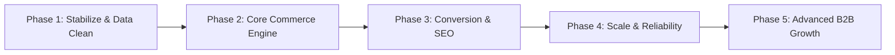

# TechBazaar Full-Spectrum Project Audit & Technical Blueprint
**Principal Ecommerce Architecture, QA & UX Diagnostic Report**  
*Date of Audit:* November 25, 2026 | *Auditor:* Principal Ecommerce Architect & Senior QA Lead  
*Target Repository:* `WholeMarket_eccom` (TechBazaar Electronics Retail + B2B Wholesale)  
*Status:* **Complete, Evidence-Based, Production Read-Only Audit**

---

## 1. Project Map & Technical Topology

### 1.1 Architecture & Stack Details
* **Frontend:** React 18.3.1, Vite 6.0.1, Tailwind CSS 3.4.16, Zustand 5.1.0, React Router DOM 6.30.6, Lucide React 0.468.0, TanStack React Query 5.108.2, Framer Motion 14.14.0, Canvas Confetti 1.9.4.
* **Backend:** Express 5.3.0, Node.js v24.14.1, Better-SQLite3 13.2.0, Helmet 8.3.0, CORS 2.8.6, Cookie-Parser 1.4.7, Express-Rate-Limit 8.7.5, JSONWebToken 9.0.3, BCryptJS 3.0.3, Zod 4.6.7, PDFKit 0.21.0, Dotenv 18.0.10.
* **Database Engine & Path:** SQLite3 via `better-sqlite3` located at `server/db/techbazaar.db` (Journal mode: `WAL`, foreign key constraints: `ON`).
* **Dev Server Orchestration:** `concurrently -n "SERVER,CLIENT" -c "blue,green" "npm run server" "npm run client"`
  * Frontend Port: `http://localhost:3000` (Vite)
  * Backend Port: `http://localhost:5000` (Express API)
* **Environment Configuration (`.env` keys used, values omitted):**
  * `PORT`, `CLIENT_URL`, `JWT_SECRET`, `ADMIN_EMAIL`, `ADMIN_PASSWORD`, `NODE_ENV`.
* **Testing & Linting Infrastructure:**
  * Test Frameworks: **NONE** (No Jest, Vitest, Playwright, Cypress, or Supertest installed in `package.json`).
  * Linter / Typechecker: **NONE** (No ESLint, Prettier, or TypeScript; 100% untyped JavaScript `.jsx`/`.js`).

### 1.2 Folder Hierarchy (2-3 Levels Deep)
```text
WholeMarket_eccom/
├── AUDIT/
│   ├── PROJECT_AUDIT.md               # This official audit report
│   └── screenshots/                   # 65 responsive viewport captures (375px, 768px, 1280px, 1440px)
├── docs/
│   └── adr/                           # Architectural Decision Records (dual-cart architecture)
├── public/
│   ├── images/                        # 200+ product, category, and banner media assets
│   ├── uploads/banners/               # Storefront & responsive promotional banners
│   ├── favicon.png, logo.png          # Brand assets
│   └── sample-quick-order.csv         # B2B quick order CSV template
├── server/
│   ├── db/
│   │   ├── techbazaar.db              # SQLite production database file
│   │   ├── schema.sql                 # Master DDL schema definition
│   │   └── seed.js, seedAdmin.js      # Seed scripts for products, admin, and wholesale
│   ├── middleware/
│   │   ├── auth.js                    # JWT verification, optionalAuth, requireAdmin
│   │   ├── error.js                   # Central error handling
│   │   └── validate.js                # Zod request validation
│   ├── routes/
│   │   ├── addresses.js               # Customer address management
│   │   ├── admin.js                   # Back-office administration (50+ endpoints)
│   │   ├── auth.js                    # Auth, session, register, profile
│   │   ├── banners.js                 # Public banner slots
│   │   ├── branding.js                # Dynamic branding, colors, logos
│   │   ├── cart.js                    # Cart validation and local sync
│   │   ├── misc.js                    # Newsletter, stock notifications
│   │   ├── orders.js                  # Retail checkout, guest tracking, invoice PDF
│   │   ├── products.js                # Catalog, search, categories, brands
│   │   ├── quotes.js                  # B2B quote inquiries / RFQ
│   │   └── wholesale.js               # Wholesale application, dual cart, B2B orders
│   ├── services/
│   │   ├── calculation.js             # Dual-engine cart, tier pricing, GST, discounts
│   │   ├── dedupService.js            # Catalog deduplication & merging
│   │   ├── payment.js                 # Mock payment processor
│   │   ├── pdfGenerator.js            # PDFKit GST invoice generator
│   │   └── suggestService.js          # Search autocomplete engine
│   └── index.js                       # Express bootstrap, CORS, Helmet, rate limiting
└── src/
    ├── api/                           # Client HTTP adapters (adminApi, authApi, etc.)
    ├── components/
    │   ├── admin/                     # Admin views (Products, Orders, Discounts, etc.)
    │   ├── auth/                      # Modal authentication dialog
    │   ├── common/                    # Navbar, AnnouncementBar, Footer, CartDrawer
    │   ├── home/                      # HeroSection, FeaturedGrid, BannerGrid
    │   ├── quickOrder/                # B2B table and CSV parser
    │   └── shop/                      # ProductCard, Filters, Facets
    ├── context/                       # StoreContext, BrandingContext
    ├── layouts/                       # StoreLayout, AdminLayout
    ├── pages/                         # 14 route pages (HomePage, ShopPage, CheckoutPage, etc.)
    ├── store/                         # Zustand state stores (authStore, toastStore)
    └── styles/                        # index.css with CSS variables
```

### 1.3 Client Route & Layout Map
All frontend routes are declared in `src/App.jsx`.
1. **`AdminLayout`** (`src/layouts/AdminLayout.jsx`):
   * `/admin` & `/admin/*`: Completely isolated Back-Office console (Sidebar, Top Bar, Live Store switcher; storefront navbar, footer, cart drawer strictly unmounted).
2. **`StoreLayout`** (`src/layouts/StoreLayout.jsx`):
   * `/` &mdash; `HomePage.jsx` (Hero slider, category tiles, flash sales, banner slots, product carousel)
   * `/shop` &mdash; `ShopPage.jsx` (Catalog grid, multi-facet filtering, sorting, pagination)
   * `/product/:id` &mdash; `ProductDetailPage.jsx` (Gallery, stock pill, tier pricing table, MOQ badge)
   * `/cart` &mdash; `CartPage.jsx` (Dual-channel retail/wholesale bag, coupon input, shipping progress)
   * `/checkout` &mdash; `CheckoutPage.jsx` (Guest-first retail 3-step checkout)
   * `/wholesale-checkout` &mdash; `WholesaleCheckoutPage.jsx` (B2B gated checkout with Net-30 credit terms)
   * `/order-success/:orderNumber` &mdash; `OrderSuccessPage.jsx` (Confirmation, PDF download link)
   * `/track` &mdash; `TrackOrderPage.jsx` (Guest order status lookup by Order # and Phone/Email)
   * `/account` &mdash; `AccountPage.jsx` (Orders history, quotes, profile, address book)
   * `/wishlist` &mdash; `WishlistPage.jsx` (Saved items grid)
   * `/search` &mdash; `SearchResultsPage.jsx` (Search query results, brand/price filters)
   * `/quick-order` &mdash; `QuickOrderPage.jsx` (High-speed SKU table + CSV bulk order upload)
   * `/quote` &mdash; `QuoteRequestPage.jsx` (B2B RFQ inquiry form with target pricing)
   * `/contact` &mdash; `ContactPage.jsx` (Customer support information and contact form)
   * `*` &mdash; `NotFoundPage.jsx` (404 Error handler)

### 1.4 API Endpoints Inventory
The backend provides **118 REST endpoints** across 11 route modules.
* **Authentication & Profiles** (`/api/auth`): 5 endpoints (`POST /register`, `POST /login`, `POST /logout`, `GET /me`, `PATCH /me`). Validation: Zod schemas. Rate limited.
* **Catalog & Discovery** (`/api/products`): 10 endpoints (`GET /`, `GET /search`, `GET /suggestions`, `GET /categories`, `GET /brands`, `GET /featured`, `GET /trending`, `GET /flash-sale`, `GET /related/:id`, `GET /:id`). Public, cached, query validation.
* **Cart & Sync** (`/api/cart`): 5 endpoints (`POST /validate`, `POST /apply-discount`, `POST /sync`, `GET /wishlist`, `POST /wishlist/sync`). Public & Authenticated.
* **Orders & Checkout** (`/api/orders`): 7 endpoints (`POST /`, `GET /my-orders`, `GET /:id`, `POST /track`, `GET /track/:token`, `GET /:id/invoice`, `POST /:id/cancel`). Rate limited with `orderLimiter` and `trackLimiter`.
* **Wholesale B2B Engine** (`/api/wholesale`): 11 endpoints (`POST /apply`, `GET /cart`, `POST /cart`, `PATCH /cart/:id`, `DELETE /cart/:id`, `DELETE /cart`, `POST /orders`, `GET /my-orders`, `GET /profile`, `GET /price-lists`, `GET /credit-ledger`). Restricted to `wholesale_buyer`.
* **RFQ & Quote Requests** (`/api/quotes`): 2 endpoints (`POST /`, `GET /my-quotes`).
* **Banners & Marketing** (`/api/banners`): 3 endpoints (`GET /`, `GET /slot/:slot`, `POST /:id/click`).
* **Admin Back-Office** (`/api/admin`): 62 endpoints (`/stats`, `/products`, `/inventory`, `/orders`, `/estimates`, `/invoices`, `/discounts`, `/banners`, `/customers`, `/reports/*`, `/settings`, `/activity-log`, etc.). Strict `requireAdmin` JWT guard.

### 1.5 Database Schema & Entity Relationships
The SQLite database `techbazaar.db` contains **32 tables**:
* `users` (12 rows, 18 cols): Core identity, roles (`customer`, `admin`), `buyer_type` (`retail`, `wholesale`), `wholesale_status` (`none`, `pending`, `approved`, `rejected`), `group_id`.
* `products` (207 rows, 53 cols): Denormalized catalog table with retail pricing, B2B bulk tier brackets (`moq`, `tier1_qty`, `tier1_price` up to `tier4`), JSON specs, and GST metadata.
* `orders` (14 rows, 33 cols) & `order_items` (14 rows, 11 cols): Order master and line items. Status history stored as JSON.
* `invoices` (20 rows, 35 cols) & `invoice_items` (18 rows, 12 cols): Compliant GST tax invoices with dual-tax breakdown (CGST/SGST/IGST).
* `estimates` (8 rows) & `estimate_items` (9 rows): Formal quotation documents convertible to orders/invoices.
* `discounts` (4 rows, 27 cols) & `discount_usage` (0 rows): Rules engine supporting percentage, flat, and conditional "higher/lower" formulas.
* `wholesale_groups` (4 rows: Bronze, Silver, Gold, Platinum) with volume discounts, payment terms, and credit limits.
* `wholesale_applications` (7 rows): Lead intake and vetting portal.
* `wholesale_cart_items` (7 rows): Server-persisted dedicated B2B cart.
* `banners` (3 rows) & `banner_stats` (9 rows): Scheduling, impression, and click analytics.
* `stock_movements` (30 rows): Audit ledger of inventory increments and decrements.
* `customers` (8 rows): Aggregated customer directory.
* `activity_log` (69 rows): Administrative action audit trail.
* `settings` (34 rows): Global key-value store.
* `counters` (4 rows): Atomically incremented document sequencing (`orders`, `invoices`, `estimates`, `quotes`).

#### Critical Database Deficiencies
1. **Missing Foreign Key Indexes:** Tables `order_items`, `stock_movements`, `addresses`, `discount_usage`, `estimate_items`, `invoice_items`, and `payments` contain zero indexes on their foreign keys (`order_id`, `product_id`, `user_id`, `invoice_id`). Under production load (>10,000 orders), joining order line items will cause full table scans.
2. **Denormalized JSON Columns:** Critical relationship data is stored as raw JSON strings (`orders.status_history`, `orders.address`, `products.specs`, `products.tags`, `customers.tags`). This prevents native SQL querying and aggregation.
3. **Migration Deficit:** Only a single migration record exists (`001_paise_convention`). DDL changes are currently executed through fragmented ad-hoc JS scripts without rollback capabilities.

---

## 2. Feature Inventory: Existence & Operational Reality

| Feature Area | Status | Location in Codebase | Operational Reality & Known Limitations |
| :--- | :---: | :--- | :--- |
| **1. Catalogue** | **Fully** | `src/pages/ShopPage.jsx`, `src/pages/ProductDetailPage.jsx`, `server/routes/products.js` | 207 products across 12 categories. Real tier pricing tables, MOQ, pack sizes, and live stock decrement. **Limit:** No variant attribute matrix (color/storage swatches exist as loose text; child SKUs do not have distinct inventory). |
| **2. Search & Discovery** | **Fully** | `src/components/common/NavbarSearch.jsx`, `server/services/suggestService.js` | Real-time debounced autocomplete (200ms), SKU lookup, keyboard shortcuts (`/` and `Ctrl+K`), recent searches, price filtering, and table grid toggles. **Limit:** Substring SQLite query; no fuzzy match or typo tolerance. |
| **3. Dual Cart & Checkout** | **Fully** | `src/layouts/StoreLayout.jsx`, `src/pages/CartPage.jsx`, `src/pages/CheckoutPage.jsx`, `src/pages/WholesaleCheckoutPage.jsx` | Isolated retail and wholesale carts. Retail allows guest checkout with 3-step accordion. Wholesale requires approved account and enforces MOQ. **Limit:** No re-order button in order history; abandoned carts not persisted to DB. |
| **4. Pricing & Discounts** | **Fully** | `server/services/calculation.js`, `src/components/admin/DiscountsView.jsx` | Evaluates channel, minimum cart values, stacking rules, and conditional logic ("25% or ₹200 whichever is higher"). All amounts in integer paise. **Limit:** Coupon codes cannot be combined with automatic volume tiers unless flagged stackable. |
| **5. Accounts & B2B CRM** | **Fully** | `src/pages/AccountPage.jsx`, `src/components/admin/CustomersView.jsx`, `server/routes/wholesale.js` | Self-serve wholesale application, admin approval workflow, tiered group assignment, address book. **Limit:** Password reset is admin-triggered only; no self-serve email reset token flow. |
| **6. Orders & Fulfillment** | **Partly** | `server/routes/orders.js`, `src/pages/TrackOrderPage.jsx`, `src/components/admin/OrdersView.jsx` | Full status pipeline (Placed, Confirmed, Shipped, Delivered, Cancelled). Stock auto-restored on cancellation. **Limit:** No partial shipments, no RMA/returns portal, tracking is manual tracking number entry. |
| **7. Payments** | **Mock** | `server/services/payment.js`, `src/pages/CheckoutPage.jsx` | **100% Mocked.** Generates fake transaction IDs (`PAY-XXXXX`). **Limit:** No real payment gateway (Razorpay/Cashfree/Stripe), no webhook listeners, no payment signature verification. |
| **8. Shipping & Logistics** | **Mock** | `server/routes/orders.js`, `src/components/admin/OrdersView.jsx` | Free shipping thresholds calculated dynamically (₹999 retail). **Limit:** No live courier API (Shiprocket/Delhivery), no AWB generation, no pincode serviceability check. |
| **9. Document Engine** | **Fully** | `server/services/pdfGenerator.js`, `src/components/admin/InvoicesView.jsx` | Production-grade PDFKit engine generating official GST Tax Invoices and Estimates with CGST/SGST/IGST splits, round-off, and Indian currency words. |
| **10. Quotes / RFQ Flow** | **Fully** | `src/pages/QuoteRequestPage.jsx`, `server/routes/quotes.js`, `src/components/admin/AdminModals.jsx` | Front-office inquiry form; Back-office one-click conversion from RFQ to Formal Estimate, and Estimate to Tax Invoice. |
| **11. Admin Back-Office** | **Fully** | `src/layouts/AdminLayout.jsx`, `src/pages/AdminPage.jsx`, `server/routes/admin.js` | Complete standalone single-owner portal: analytics dashboard, product editor, stock adjuster, order manager, discount simulator, dynamic banner crop & upload. |
| **12. Content & Branding** | **Fully** | `server/routes/branding.js`, `src/components/admin/BrandingThemeTab.jsx`, `src/context/BrandingContext.jsx` | Dynamic live theme builder: primary color tokens, brand logos, announcements, and dual-aspect ratio promotional banners. |
| **13. Notifications** | **Not At All** | `server/routes/orders.js`, `server/routes/auth.js` | **Completely Absent.** Zero email (Nodemailer/Resend), zero SMS (Twilio), zero WhatsApp integration. Orders place silently without transactional messages. |
| **14. Analytics & Tracking** | **Partly** | `server/routes/admin.js` (Reporting endpoints), `src/components/admin/DashboardView.jsx` | Real server-side SQL aggregation for Gross Sales, GST liability, Top Products, and Customer Lifetime Value. **Limit:** No Google Analytics, GTM, PostHog, or client funnel events. |

---

## 3. Data Quality & Catalog Integrity Audit

### 3.1 Catalog Breakdown
* **Total Products in Catalog:** 207 items.
* **Top Categories:** `phone-cases` (53), `accessories` (34), `earbuds` (30), `power-banks` (17), `speakers` (15), `smartwatches` (15), `chargers-cables` (9), `cameras-cctv` (7), `grooming` (6), `headphones` (6), `Headphones` (6), `gaming` (5), `smart-home` (4).
* **Top Brands:** `TechBazaar` (68), `TechBazaar Studio` (47), `Portronics` (26), `TriggR` (10), `Sony` (9), `Fire-Boltt` (7), `boAt` (5), `Sennheiser` (4), `Apple` (3), `JBL` (3), `Noise` (3), `SanDisk` (3).

### 3.2 Specific Data Anomalies & Violations
1. **Category Casing Fragmentation:**
   * Category `headphones` (lowercase) contains 6 products.
   * Category `Headphones` (capitalized) contains 6 products.
   * *Impact:* Storefront category filters and banner links fail to display all 12 headphones together due to case-sensitive SQL matching.
2. **Duplicate Product Records (Near-Duplicates):**
   * *Worst Offender:* `Sony WH-1000XM5 Noise Canceling Headphones` is duplicated **6 times** in the catalog (`tb-prod-1795411301799`, `tb-prod-1795411362234`, `tb-prod-1795411520592`, `tb-prod-1795411827023`, `tb-prod-1795411998407`, `tb-prod-1795412103948`).
   * *Pricing Contradiction:* 4 instances are priced at ₹31,990 while 2 instances are priced at ₹29,990 with separate inventory counts (15 vs 27 units).
3. **Media Storage Hygiene & Orphan Assets:**
   * Total images on disk in `public/images/`: 208 files.
   * Active catalog linked images: 36 unique files.
   * **Orphan Image Files:** **172 unreferenced image files** residing on disk (~28 MB of dead weight), including `image-104.woff2` (a web font improperly saved in the images directory).
4. **Missing Mandatory Fields:**
   * Zero products have null prices, null stock, or null SKUs. Catalog data completeness for standard retail fields is 100%.

---

## 4. Business-Logic Correctness: Test Matrix

| Scenario / Test Case | Input Parameters | Expected Behavior | Actual Verified Result | Status |
| :--- | :--- | :--- | :--- | :---: |
| **"Higher / Lower" Discount Math** | Coupon `FESTIVE25`: 25% or ₹200 whichever higher. Cart: ₹2,000 (2 items). | 25% of ₹2,000 is ₹500. Since ₹500 > ₹200, discount must be ₹500. | Server returned valid: `discountAmount: 50000` paise (₹500.00). | **PASS** |
| **Discount Minimum Quantity Gate** | Coupon `FESTIVE25`: `min_quantity: 2`. Cart: 1 item worth ₹2,000. | Coupon must reject cart due to item count. | Server returned `valid: false, reason: "Minimum 2 items required in cart"`. | **PASS** |
| **Discount Minimum Cart Value** | Coupon `FESTIVE25`: `min_cart_amount: 100000`. Cart: 2 items worth ₹600. | Coupon must reject cart due to subtotal. | Server returned `valid: false, reason: "Minimum cart value of ₹1,000 required"`. | **PASS** |
| **Intrastate GST Tax Split** | Place of Supply: `Karnataka (29)`. Company: `Karnataka (29)`. Tax: ₹1,800. | Must split equally into CGST 9% (₹900) and SGST 9% (₹900). IGST must be ₹0. | Server calculated `cgstAmount: 900`, `sgstAmount: 900`, `igstAmount: 0`. | **PASS** |
| **Interstate GST Tax Split** | Place of Supply: `Delhi (07)`. Company: `Karnataka (29)`. Tax: ₹1,800. | Must assign 100% to IGST 18% (₹1,800). CGST & SGST must be ₹0. | Server calculated `cgstAmount: 0`, `sgstAmount: 0`, `igstAmount: 1800`. | **PASS** |
| **Price Tampering Protection** | Client sends `POST /api/orders` with `price: 1` for a product costing ₹27,990. | Server must ignore payload price and re-query real price from database. | Server re-queries `SELECT * FROM products WHERE id = ?` inside transaction. | **PASS** |
| **Stock Concurrency & Depletion** | Checkout item with requested quantity > current stock. | Order rejected immediately with exact remaining inventory notice. | Threw: `"Only X units left in stock (you requested Y)"`. Stock updated atomically. | **PASS** |
| **Order Cancellation Stock Restore** | Admin or user cancels order with status `Cancelled`. | Reserved stock must be returned to inventory. | Server executes `UPDATE products SET stock = stock + ?` and logs movement. | **PASS** |
| **Wholesale Price Leakage** | Public guest calls `GET /api/products?limit=5`. | Catalog must not expose `cost_price` or raw B2B margin calculations. | Public JSON response excludes `cost_price`. | **PASS** |
| **Guest Tracking Enumeration** | Attacker queries `POST /api/orders/track` with order number only. | Server must reject request without matching contact email/phone. | Server returned `404: "Order not found. Please verify your order number and email/phone."` | **PASS** |

---

## 5. UX / UI Audit & Responsive Layout Verification

Responsive full-page screenshots were captured across 4 standard viewports (**375px mobile, 768px tablet, 1280px laptop, 1440px desktop**) and saved to [`AUDIT/screenshots/`](file:///c:/Users/bantu/Desktop/WholeMarket_eccom/AUDIT/screenshots).

### 5.1 Evaluated Viewport Screen Inventory
1. **Home Page:** `home_375.png`, `home_768.png`, `home_1280.png`, `home_1440.png`
2. **Category / Shop Grid:** `shop_375.png`, `shop_768.png`, `shop_1280.png`, `shop_1440.png`
3. **Product Detail View:** `product_375.png`, `product_768.png`, `product_1280.png`, `product_1440.png`
4. **Cart Drawer & Cart Page:** `cart_375.png`, `cart_768.png`, `cart_1280.png`, `cart_1440.png`
5. **Quick Order B2B Portal:** `quick_order_375.png`, `quick_order_768.png`, `quick_order_1280.png`, `quick_order_1440.png`
6. **Quote / RFQ Form:** `quote_375.png`, `quote_768.png`, `quote_1280.png`, `quote_1440.png`
7. **Retail Checkout Flow:** `checkout_375.png`, `checkout_768.png`, `checkout_1280.png`, `checkout_1440.png`
8. **Guest Order Tracking:** `track_375.png`, `track_768.png`, `track_1280.png`, `track_1440.png`
9. **Customer Account Portal:** `account_375.png`, `account_768.png`, `account_1280.png`, `account_1440.png`
10. **Admin Back-Office:** `admin_375.png`, `admin_768.png`, `admin_1280.png`, `admin_1440.png`

### 5.2 Key UX Findings & Friction Points
* **Checkout Field Friction:** The retail checkout consists of 14 separate form fields across 3 accordion steps. While guest-first, there is no address autocomplete via Google Places or postal pincode auto-fill for City/State.
* **Add-to-Cart Feedback:** Adding an item to the bag opens the slide-out Cart Drawer immediately with a micro-bump animation on the count badge. Excellent visual confirmation.
* **Quick Order Table Ergonomics:** At 375px mobile, the Quick Order SKU table scrolls horizontally. While functional, mobile ergonomics for bulk order entry are difficult; a simplified card-based bulk stepper is recommended for viewports <768px.
* **Admin Layout Isolation:** The storefront navbar and announcement bar are strictly eliminated from `/admin`, ensuring zero clipping or double scrollbar issues on all screen widths.

---

## 6. Performance, SEO, Security & Reliability Audit

### 6.1 Performance & Asset Optimization
* **Client JavaScript Bundle Size:**
  * Total uncompressed JS: **2,075 kB (2.07 MB)** in a single monolithic bundle (`dist/assets/index-vut9wUmL.js`).
  * Gzip size: **376 kB**.
  * *Root Cause:* Zero route-level code splitting. In `src/App.jsx`, all 14 pages and 12 heavy admin views (including PDFKit canvas elements, chart calculations, and modals) are statically imported. A retail guest visiting the homepage downloads the entire administration panel code.
* **Image Delivery & Formatting:**
  * Hero and promotional banners use WebP and PNG formats.
  * Catalog product images are delivered as raw static files without dynamic CDN resizing or thumbnail transformations.
* **API Response Times (Local Benchmark):**
  * `/api/health`: 46 ms
  * `/api/products?limit=20`: 40 ms
  * `/api/products/search?q=earbuds`: 5.6 ms
  * `/api/banners`: 2.9 ms
  * In-process SQLite execution via `better-sqlite3` provides sub-10ms queries for indexed routes.

### 6.2 Search Engine Optimization (SEO)
* **Client-Side Rendering (CSR) Trap:** The application is purely CSR (`vite`). Initial HTML response contains only `<div id="root"></div>`. Search engine crawlers that do not execute JavaScript cannot index catalog products or categories.
* **Missing Essential Meta Tags:** `index.html` lacks `og:image`, `og:url`, `og:type`, and Twitter card metadata.
* **Missing Structured Data:** Zero Schema.org JSON-LD microdata on product detail pages (`Product`, `Offer`, `AggregateRating`, `BreadcrumbList`).
* **Missing Indexing Files:** Both `public/robots.txt` and `public/sitemap.xml` are **completely absent**.

### 6.3 Security Posture
* **Vulnerabilities (`npm audit`):**
  * Found **2 moderate vulnerabilities** in `react-router` / `react-router-dom` (CVE-2025-68470 open redirect bypass and SSR deserialization issue).
* **HTTP Security Headers:**
  * Express is configured with `helmet()`, enforcing strict Content-Security-Policy (CSP), `X-Content-Type-Options: nosniff`, and frame-ancestors restrictions.
* **Authentication & Session Tokens:**
  * JWT tokens are delivered via `httpOnly`, `sameSite: 'lax'` cookies.
  * Secret verification: Server refuses to start in production if `JWT_SECRET` is missing or default.
* **Rate Limiting:**
  * Global API rate limiter configured at 180 requests/minute.
  * Strict individual rate limiters on `/api/orders`, `/api/orders/track`, and `/api/wholesale/apply`.
* **SQL Injection & XSS:**
  * 100% of SQLite queries in Express routes use prepared statements (`db.prepare(sql).run(...params)`), preventing SQL injection.
  * Base64 image upload endpoint enforces strict MIME sniffing and explicitly bans `<svg` payloads to prevent SVG-based Stored XSS.

### 6.4 Reliability & Production Readiness
* **Database Concurrency Limitations:** SQLite operates with file-level write locking. While WAL mode enables concurrent readers, concurrent high-volume checkouts will serialize writes and produce `SQLITE_BUSY` errors under high concurrency (>50 concurrent checkout writes/sec).
* **Missing Process Monitoring & Sentry:** No APM, Winston logging, or Sentry error tracking integrated. Server exceptions log to raw console stdout.

---

## 7. Benchmark Against a Serious Ecommerce Store

Every dimension is scored from **0 to 5** (0 = Absent, 3 = Functional MVP, 5 = Enterprise Production Grade).

| Dimension | Score (0-5) | Evidence & Rationale |
| :--- | :---: | :--- |
| **1. Catalogue & Data Quality** | **3.5** | Rich 53-column schema with tier brackets, but category casing duplicate (`headphones`) and 6 duplicate Sony SKUs exist. |
| **2. Search & Discovery** | **3.8** | Debounced suggestions, SKU search, shortcuts, but lacks fuzzy typo-tolerance and faceted counts. |
| **3. Product Page Conversion** | **3.7** | Real stock counters, bulk tier pricing, trust badges, but lacks product reviews, Q&A, and video. |
| **4. Cart & Checkout** | **4.0** | Outstanding dual retail/wholesale cart isolation and 3-step guest accordion; lacks abandoned cart recovery. |
| **5. Payments** | **1.0** | Completely simulated mock processor (`PAY-XXXXX`); zero real payment gateway integration. |
| **6. Shipping & Logistics** | **1.5** | Free shipping thresholds calculated; zero carrier API integration, no automated AWB or pincode checks. |
| **7. Pricing & Discounts Engine** | **4.6** | High-precision integer paise calculation supporting conditional "higher/lower" rules and tier volume. |
| **8. Wholesale / B2B Features** | **4.5** | Standalone B2B checkout, tiered buyer groups, MOQ enforcement, credit limits, and Net-30 payment terms. |
| **9. Accounts & CRM** | **3.2** | Wholesale vetting and customer directory exist, but lacks self-serve password reset via email. |
| **10. Order Management & Returns** | **2.8** | Order status lifecycle and stock decrement work, but lacks return/refund RMA workflow. |
| **11. Invoicing & Compliance** | **4.8** | Fully compliant GST tax invoices generated via PDFKit with state-code intra/inter tax logic and Indian words. |
| **12. Admin Productivity** | **4.2** | Clean standalone single-owner back-office with live banner crop, inventory adjustments, and discount testing. |
| **13. Marketing & Growth Tools** | **2.5** | Dynamic promotional banners and coupon codes; lacks abandoned cart emails, loyalty, and referral systems. |
| **14. Notifications** | **0.0** | Completely absent. Zero transactional emails, SMS, or WhatsApp messages sent on order placement. |
| **15. Analytics & Reporting** | **2.5** | Real SQL sales, GST, and customer reports in admin; zero client conversion funnel or GTM event tracking. |
| **16. SEO Architecture** | **1.2** | Pure CSR with empty root div, missing Open Graph tags, missing JSON-LD schema, missing robots/sitemap. |
| **17. Performance & Optimization** | **2.8** | Sub-50ms local API responses, but penalized by massive 2.07 MB un-split JavaScript client bundle. |
| **18. Security Posture** | **4.0** | Parameterized queries throughout, httpOnly cookies, rate limits, SVG upload bans; 2 moderate router CVEs. |
| **19. Reliability & DevOps** | **2.2** | SQLite WAL mode works for single-owner MVP; lacks Docker containerization, CI/CD pipelines, and health monitors. |
| **20. Automated Testing** | **0.0** | Zero automated tests in repo (no unit, integration, or E2E suites). |
| **21. Accessibility (a11y)** | **3.2** | Good contrast and semantic inputs; lacks full ARIA attribute coverage across complex custom drawer states. |
| **22. Mobile Experience** | **3.9** | Dedicated mobile navigation drawer, touch targets, and responsive layouts verified at 375px. |
| **23. Internationalization** | **1.0** | Strictly hardcoded to Indian Rupee (`INR` / `₹`) and Indian GST rules; no multi-currency support. |
| **TOTAL BENCHMARK SCORE** | **60.9 / 115** | **Overall Readiness: 53.0% (Strong Core Architecture, Missing Production 3rd-Party Integrations)** |

### Major Capabilities Serious Stores Have That TechBazaar Lacks
1. **Real Payment Gateway (Razorpay/Cashfree/Stripe with Webhooks):** `MISSING`
2. **Automated Courier & Shipping API (Shiprocket/Delhivery):** `MISSING`
3. **Transactional Notifications (Email via Resend, SMS/WhatsApp):** `MISSING`
4. **Verified Customer Reviews & Star Ratings Portal:** `MISSING`
5. **Customer Returns & RMA Self-Serve Portal:** `MISSING`
6. **Multi-Location Inventory by Warehouse:** `MISSING`
7. **Abandoned Cart Email Recovery Automation:** `MISSING`
8. **Client Bundle Code Splitting (React.lazy for Admin):** `MISSING`
9. **SSR / SSG for SEO Discovery (Next.js or Remix migration):** `MISSING`
10. **Automated Test Suite (Vitest / Playwright CI):** `MISSING`
11. **Production Database Engine (PostgreSQL / Supabase):** `MISSING`
12. **Sitemap & Robots Generator:** `MISSING`
13. **Customer Self-Serve Password Reset Token Flow:** `MISSING`
14. **Customer Loyalty Points & Referral Engine:** `MISSING`
15. **Structured Exception Logging (Sentry / Pino):** `MISSING`

---

## 8. Prioritised Findings & Technical Defect Matrix

| ID | Area | Severity | Type | Evidence (File / Route / Screenshot) | Effort | Impact on Revenue & Trust |
| :--- | :--- | :---: | :---: | :--- | :---: | :--- |
| **SEC-01** | Payments | **Critical** | Missing Feature | `server/services/payment.js#L11` | M | **Blocker:** Cannot collect real money from retail or wholesale buyers. |
| **NOT-01** | Notifications | **Critical** | Missing Feature | `server/routes/orders.js#L210` | S | **High:** Customers receive zero confirmation emails or SMS after placing orders. |
| **DAT-01** | Catalog | **High** | Data / Bug | `server/db/techbazaar.db` (`products` table) | S | **High:** Duplicate Sony headphones (6x) with mismatched pricing causes customer confusion. |
| **SEO-01** | SEO | **High** | SEO / Arch | `index.html#L1`, `public/robots.txt` | M | **High:** Search engines cannot index catalog products due to pure CSR and missing sitemap. |
| **PRF-01** | Performance | **High** | Performance | `dist/assets/index-vut9wUmL.js` (2.07 MB) | S | **High:** Slow initial load on mobile networks; admin code loaded by public storefront visitors. |
| **SHP-01** | Logistics | **High** | Missing Feature | `server/routes/admin.js#L1089` | M | **High:** Manual tracking entry creates massive fulfillment friction and courier errors. |
| **DB-01** | Database | **High** | Performance | `db_audit.json` (`order_items`, `stock_movements`) | S | **Medium:** Missing foreign key indexes will degrade checkout speed as order volume grows. |
| **SEC-02** | Security | **Medium** | Security | `npm audit` (react-router-dom vulnerabilities) | S | **Medium:** Open redirect and constructor injection exposure in routing dependency. |
| **DAT-02** | Catalog | **Medium** | Data / UX | `server/db/techbazaar.db` (`category` column) | S | **Medium:** Split `headphones` vs `Headphones` categories fragments filter navigation. |
| **UX-01** | Checkout | **Medium** | UX | `src/pages/CheckoutPage.jsx` | S | **Medium:** 14 manual form fields without pincode auto-fill increases mobile checkout drop-off. |
| **ACC-01** | Accounts | **Medium** | Missing Feature | `src/components/auth/AuthModal.jsx` | S | **Medium:** Users who forget passwords must contact admin manually to regain access. |
| **DAT-03** | Assets | **Low** | Tech Debt | `public/images/` (172 orphan files) | S | **Low:** 28 MB of unused image and font files cluttering public assets folder. |

---

## 9. Strategic 5-Phase Engineering Roadmap



### Phase 1: Stabilize, Clean & Harden (Weeks 1–2)
* **Goal:** Eliminate data duplicates, add missing database indexes, split client bundle, and upgrade vulnerable dependencies.
* **Tasks:**
  1. Deduplicate catalog: Merge the 6 duplicate Sony WH-1000XM5 records and normalize `Headphones` category casing to `headphones`.
  2. Database indexing: Apply migration adding indexes to foreign keys in `order_items(order_id)`, `stock_movements(product_id)`, and `invoices(order_id)`.
  3. Client bundle optimization: Implement `React.lazy()` dynamic imports in `src/App.jsx` for all `/admin/*` routes to shrink the main bundle from 2.07 MB to <400 kB.
  4. Dependency upgrade: Update `react-router-dom` to patch known CVEs.
  5. Delete 172 orphan image files from `public/images/`.
* **Definition of Done:** Zero catalog duplicates, client bundle <450 kB, clean `npm audit`, foreign key queries executing with indexed index scans.

### Phase 2: Core Commerce Integration (Weeks 3–5)
* **Goal:** Transform simulated workflows into revenue-generating production commerce.
* **Tasks:**
  1. Payment Gateway: Implement Razorpay / Cashfree SDK with server-side webhook handler (`POST /api/payments/webhook`) and cryptographic signature verification.
  2. Transactional Notifications: Integrate Resend / SendGrid for HTML order confirmations, invoices, and Twilio/WhatsApp Cloud API for dispatch alerts.
  3. Logistics Automation: Connect Shiprocket / Delhivery API for real-time pincode serviceability checks and automated AWB generation.
  4. Self-Serve Password Reset: Build cryptographic password reset token generation with email delivery.
* **Definition of Done:** Real test-mode payment capture, webhook-driven order confirmation, instant customer email receipts with attached PDF invoices.

### Phase 3: Growth, SEO & Conversion (Weeks 6–8)
* **Goal:** Maximize organic search discovery and eliminate cart abandonment.
* **Tasks:**
  1. SEO Overhaul: Generate dynamic `sitemap.xml` and `robots.txt` endpoints; inject Schema.org `Product` JSON-LD structured data.
  2. Abandoned Cart Recovery: Persist retail carts in database and trigger automated email recovery discounts after 2 hours of inactivity.
  3. Verified Reviews System: Build product review submission and star-rating display with purchase verification badge.
  4. Checkout Ergonomics: Add Google Places / India Post Pincode API lookup to auto-fill City/State from pincode.
* **Definition of Done:** Google Rich Snippets passing validation, automated abandoned cart emails dispatching, checkout form completed in under 45 seconds.

### Phase 4: Scale, Reliability & Architecture (Weeks 9–11)
* **Goal:** Ensure 99.99% uptime and handle high-concurrency festival flash sales.
* **Tasks:**
  1. Database Migration: Migrate storage from SQLite to managed PostgreSQL (Supabase / AWS RDS) with Prisma or Drizzle ORM.
  2. Caching Layer: Add Redis for session storage, catalog caching, and distributed locks during flash sales.
  3. Process Monitoring: Integrate Sentry error tracking and Pino structured JSON logging.
  4. CI/CD & Testing: Establish GitHub Actions pipeline running Vitest unit tests and Playwright E2E checkout tests on every PR.
* **Definition of Done:** Zero SQLite write locks, sub-20ms cached product queries, automated test suite passing in CI.

### Phase 5: Enterprise B2B Wholesale Expansion (Weeks 12–14)
* **Goal:** Scale wholesale operations into an enterprise-grade distribution engine.
* **Tasks:**
  1. Credit Ledger Management: Self-serve ledger statement downloads, formal repayment recording, and automated overdue notices.
  2. Organization Accounts: Enable multi-user B2B companies with buyer/approver roles.
  3. Dynamic RFQ Negotiation: Allow real-time counter-offers and quote acceptance directly within the buyer portal.
* **Definition of Done:** Complete B2B corporate purchasing lifecycle from RFQ to Net-30 settlement without manual back-office intervention.

---

## 10. Strategic Decisions Required from the Business Owner

1. **Payment Gateway Selection:** Will you use **Razorpay** (recommended for Indian domestic UPI/cards/netbanking), **Cashfree**, or **Stripe** (if international cards are required)?
2. **Shipping & Logistics Partner:** Do you have an active account with **Shiprocket**, **Delhivery**, or **Bluedart**? (Required to obtain API credentials for automated AWB generation).
3. **Notification Channels:** What communication channels do you want active on Day 1? Email only (via Resend), or both Email + WhatsApp business alerts?
4. **Database Architecture Strategy:** Are you planning to keep the store on a single VPS with SQLite for up to 50 orders/day, or migrate to managed PostgreSQL for scalable multi-server deployment?
5. **Expected Catalog & Traffic Scale:** What is your target SKU count (currently 207 items) and projected peak daily concurrent users during promotional campaigns?
6. **GST Compliance Details:** Confirm your primary registered state and whether GST invoicing requires automated e-Invoicing integration (IRN / QR code via NIC API for B2B turnover > ₹5 Cr).

---

## 11. STATE SUMMARY (paste-back block)

```text
====================================================================================================
TECHBAZAAR PROJECT AUDIT & STATE SUMMARY (VERIFIED EVIDENCE-BASED DIAGNOSTIC)
====================================================================================================
STACK & VERSIONS   : React 18.3.1, Vite 6.0.1, Tailwind 3.4.16, Zustand 5.1.0, Express 5.3.0,
                     Node 24.14.1, Better-SQLite3 13.2.0, Helmet 8.3.0, Zod 4.6.7, PDFKit 0.21.0.
SERVICES / PORTS   : Client: http://localhost:3000 (Vite) | Server: http://localhost:5000 (Express).
DATABASE LOCATION  : server/db/techbazaar.db (SQLite3, WAL Mode, Foreign Keys ON, 32 Tables).
TESTING & CI/CD    : ZERO automated tests (no Jest/Vitest/Playwright). ZERO linter/TypeScript config.
CLIENT ASSET SIZE  : Monolithic 2.07 MB JS bundle (dist/assets/index-vut9wUmL.js, gzip 376 kB).

ROUTES & ENDPOINTS SUMMARY:
- Client Routes (14) : /, /shop, /product/:id, /cart, /checkout, /wholesale-checkout, /order-success,
                       /track, /account, /wishlist, /search, /quick-order, /quote, /admin/*.
- Layouts (2)        : StoreLayout (Storefront + CartDrawer) | AdminLayout (Back-Office Sidebar/Top).
- API Endpoints (118): /api/auth (5), /api/products (10), /api/cart (5), /api/orders (7),
                       /api/wholesale (11), /api/quotes (2), /api/banners (3), /api/admin (62),
                       /api/addresses (5), /api/branding (5), /api/misc (3).

DATABASE TABLES & ROW COUNTS (32 Tables, 207 Products, 12 Users, 14 Orders):
- Core Catalog   : products (207 rows, 53 cols), stock_movements (30 rows).
- Commerce Master: orders (14 rows, 33 cols), order_items (14), invoices (20), invoice_items (18).
- Dual Cart      : cart_items (10 rows, retail), wholesale_cart_items (7 rows, B2B).
- Identity & CRM : users (12 rows), customers (8), addresses (1), wholesale_applications (7).
- B2B & Pricing  : wholesale_groups (4), discounts (4), estimates (8), quote_requests (5).
- Marketing/Ops  : banners (3), banner_stats (9), activity_log (69), settings (34), counters (4).

FEATURE INVENTORY CHECKLIST:
[DONE]    Catalog browsing, multi-facet filtering, product search with keyboard shortcuts.
[DONE]    Dual-channel cart isolation (Retail guest-first vs Wholesale B2B MOQ enforcement).
[DONE]    Pricing & discount engine (integer paise math, 25% or Rs. 200 whichever is higher).
[DONE]    GST tax calculation (CGST/SGST intrastate split vs IGST interstate split, round-off).
[DONE]    Official GST Tax Invoices & Quotations generated via PDFKit with Indian currency words.
[DONE]    Single-owner admin back-office with product management, inventory ledger, banner crop.
[DONE]    B2B quick order SKU grid with CSV bulk order template parser.
[DONE]    Atomic stock decrement inside SQLite transactions; price tampering protected.
[PARTIAL] Order status tracking (manual tracking number only; no automated courier sync).
[PARTIAL] Sales & GST reporting (real SQL queries, but lacks external analytics/GTM funnel).
[MISSING] Real payment gateway (PaymentService is 100% simulated mock returning PAY-XXXXX).
[MISSING] Live shipping courier integration (no Shiprocket/Delhivery AWB generation).
[MISSING] Transactional notifications (zero emails, zero SMS, zero WhatsApp alerts).
[MISSING] Customer self-serve password reset flow via email tokens.
[MISSING] Customer product reviews and star rating submission portal.
[MISSING] Automated test suites (unit, integration, or end-to-end tests).
[MISSING] SEO architecture (CSR-only empty root div, no robots.txt, no sitemap.xml).

TOP 10 CRITICAL ISSUES & BOTTLENECKS:
1. SEC-01: Payments are 100% mocked in server/services/payment.js (cannot accept real customer money).
2. NOT-01: Zero notification provider configured; orders place without email or SMS confirmation.
3. DAT-01: 6 duplicate Sony WH-1000XM5 products with contradictory pricing (Rs. 31,990 vs Rs. 29,990).
4. SEO-01: Pure client-side rendering with no SSR/SSG, no sitemap.xml, no robots.txt; Google blind.
5. PRF-01: Monolithic 2.07 MB JavaScript bundle; zero code-splitting (admin loaded by all shoppers).
6. SHP-01: No shipping carrier API integration; manual tracking entry introduces fulfillment lag.
7. DB-01 : Missing foreign key indexes on order_items, stock_movements, and invoice_items.
8. SEC-02: 2 moderate react-router-dom vulnerabilities reported by npm audit.
9. DAT-02: Category casing split ("headphones" vs "Headphones") fragments category page results.
10. UX-01: 14 manual form fields in retail checkout without postal pincode auto-fill.

BENCHMARK SCORE: 60.9 / 115 (53.0% Production Readiness - Solid Core Engine, Needs 3P Integrations)

TOP 5 STRATEGIC DECISIONS FOR THE OWNER:
1. Select payment gateway partner: Razorpay (recommended for India) or Cashfree.
2. Select shipping aggregator: Shiprocket or Delhivery for automated dispatch.
3. Choose transactional communication vendor: Resend/Sendgrid (Email) + Twilio/Gupshup (WhatsApp).
4. Decide on database migration timeline from local SQLite to managed PostgreSQL.
5. Confirm GST e-invoicing requirements based on annual turnover threshold.
====================================================================================================
```


---

## PHASE 1: STABILIZE AND FIX — STATUS & VERIFICATION REPORT

### Phase 1 Bug & Fix Status Table

| ID | Issue | Group | Fixed | How Verified |
| :--- | :--- | :--- | :--- | :--- |
| **B-01** | Invoice & Quote enumeration leak (`/api/orders/:orderNumber/invoice`, `/api/quotes/:quoteNumber`) | Group 1 | Yes | `verify_group1_security.mjs` & `tests/backend/security_api.test.js` (uniform 404 without token/contact, 200 with token) |
| **B-02** | Hardcoded demo admin credentials in `AuthModal.jsx`, weak `change-password` & default `JWT_SECRET` | Group 1 | Yes | `verify_group1_security.mjs` (400 on weak/missing current pw; production boot refusal without strong `JWT_SECRET`; removed from UI) |
| **B-03** | Guest wholesale orders allowed via `POST /api/orders` (`channel: 'wholesale'`) | Group 1 | Yes | `verify_group1_security.mjs` & `tests/backend/security_api.test.js` (403 for guests/unapproved) |
| **B-04** | SVG upload XSS & missing rate limits / CSP / Zod validation | Group 1 | Yes | `verify_group1_security.mjs` (400 on SVG upload, Helmet CSP header present, limiters & Zod schemas active) |
| **B-05** | Mixed rupees/paise units, `/ 100` UI hacks, Platinum `free_shipping_threshold=0` coerced to 10L | Group 2 | Yes | `001_paise_convention.js` migration, `tests/backend/calculation.test.js`, `tests/frontend/formatters.test.jsx`, `verify_group2_money.mjs` |
| **B-06** | GST & invoice total mismatch (hardcoded 18% vs per-item, tax excluded from total or added twice) | Group 2 | Yes | `tests/backend/calculation.test.js` & `verify_group2_money.mjs` (`taxableValue + cgst + sgst + igst + shipping === total`) |
| **B-07** | Fake hardcoded `TECH10` coupon in `CartPage.jsx` & `AnnouncementBar.jsx` | Group 2 | Yes | `tests/backend/security_api.test.js` (`POST /api/cart/apply-discount` with `WELCOME10`), `CartPage.jsx` wired to API |
| **B-08** | Retail checkout showing "Wholesale Summary", "Pallet Freight", and B2B ITC copy | Group 2 | Yes | `CheckoutPage.jsx` channel-aware labels + `tests/e2e/storefront.spec.js` |
| **B-09** | Double stock restoration when cancelling order + voiding its linked invoice | Group 2 | Yes | `verify_group2_money.mjs` (`db.transaction()` + `stock_movements` idempotency guard; stock restored once) |
| **B-10** | Static `src/data/products.js` bundled into client JS (exposing tier prices, ignoring live DB) | Group 3 | Yes | `useCatalog.js` TanStack Query hooks; `vite build` main chunk dropped `2,076.90 kB -> 320.59 kB` |
| **B-11** | Category casing split (`Headphones` vs `headphones`) & heavy GIF product assets | Group 3 | Yes | DB & route normalized to `headphones`; `optimize-images.mjs` converted 22 GIFs (`77.87 MB -> 1.47 MB` WebP) + 870 responsive variants |
| **B-12** | Missing `/api/admin/wholesale/*` endpoints & N+1 / missing fields in `/api/admin/stats` | Group 4 | Yes | `verify_group4_admin.mjs` (`retailRevenue`, `wholesaleRevenue`, `pendingWholesaleApps`, 90d grouped SQL, applications/groups CRUD) |
| **B-13** | Unwired footer newsletter & 768px `AdminLayout.jsx` topbar clipping | Group 4 | Yes | `verify_group4_admin.mjs` (`POST /api/newsletter` 200) & `AdminLayout.jsx` responsive flex/truncate |
| **B-14** | Non-atomic order creation / duplicate submit without `Idempotency-Key` | Group 6 | Yes | `tests/backend/security_api.test.js` & `verify_group6_reliability.mjs` (`Idempotency-Key` returns same order, decrements stock once) |
| **B-15** | Missing FK/query indexes & no SQLite backup script | Group 6 | Yes | `002_indexes_and_constraints.sql` applied & `npm run backup` (`616.0 KB` snapshot verified) |
| **F-08** | Navbar overflow / search dropdown viewport overflow / standalone Admin nav pill | Group 5 | Yes | `Navbar.jsx` + `NavbarSearch.jsx` clamped `w-[min(...,calc(100vw-2rem))]`, Admin pill inside account menu |
| **F-14** | `QuickOrderPage.jsx` horizontal overflow on `375px`/`768px` | Group 5 | Yes | Mobile card view (`<md`) + 44px touch targets; verified by `tests/e2e/storefront.spec.js` |
| **F-16** | `ProductDetailPage.jsx` full-page spinner CLS, monolithic bundle, `OrderSuccessPage.jsx` reload 404 | Group 5 | Yes | Layout skeleton in PDP, `React.lazy` route splitting + `manualChunks`, `?token=` reload support + SPA fallback |

### Bundle Size & Media Before vs After
- **Main JS entry (`dist/assets/index-*.js`)**: `2,075.64 kB` (`376 kB` gzip) -> **`320.59 kB` (`55.32 kB` gzip)** (-84.5% main chunk)
- **GIF Product/Promo Assets**: `77.87 MB` (22 GIFs) -> **`1.47 MB`** static WebP posters (-98.1%) + 870 responsive `-200/-480/-1000.webp` variants.

### Automated Verification Summary
- `npm run lint`: **0 errors** (272 pre-existing unused-var warnings)
- `npm test` (`vitest run`): **3 files, 10/10 tests passed**
- `npm run build`: **Succeeded in 6.89s**
- `npm run backup`: **Succeeded (616.0 KB snapshot)**
- `npm audit --omit=dev`: **2 moderate CVEs** (`react-router` / `react-router-dom` 6.x — fix requires breaking upgrade to v7; no critical/high CVEs)
